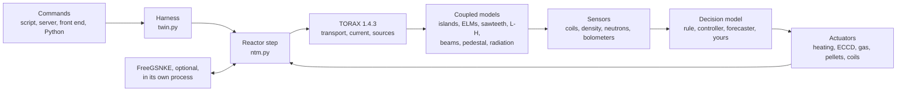

[](https://github.com/Haripratiik/expanded-torax/actions/workflows/quickstart.yml)

## What is Expanded TORAX?

Expanded TORAX is a whole-device tokamak simulator for testing real-time plasma control. It runs [TORAX](https://github.com/google-deepmind/torax) 1.4.3, Google DeepMind's core transport simulator, without modifying it, and couples to each TORAX step the physics a control test needs: magnetic islands, ELMs, sawteeth, L-H transitions, neutral beams, the edge pedestal, radiation, a free boundary and synthetic sensors. A harness lets a script, an AI agent or a person drive the plasma while it runs. Expanded TORAX is written in Python, with the following motivations:

- Closed-loop tests of controllers, decision models and neural surrogates, on plasmas whose accuracy is measured against real MAST shots, and on ITER, SPARC and MAST-U, which no shot here checks and which are labelled as such
- Exact branches: a snapshot holds everything a step reads, so two actions can be compared from the same plasma state
- One set of named commands for scripts, a local server, a browser front end and Python
- Every model tagged by its level (TORAX's own, a published reduced equation, a published multi-machine law, or a prescribed what-if), with no law fitted to MAST in the general code

Expanded TORAX, at release 1.2, has the following physics and harness feature set (modules in `core/`):

- Core transport from TORAX: heat, particles and current on the plasma's flux surfaces, a 1.5D model with the shape given
- Neoclassical tearing modes (magnetic islands) from the modified Rutherford equation with published terms: growth, rotation, braking and locking, seeded by sawteeth, ELMs and beta collapses, and shrunk by ECCD (`ntm.py`)
- Type I ELMs from the exhaust power, and Porcelli's sawtooth trigger with its thermal terms (`ntm.py`, `porcelli.py`, `coupled.py`)
- L-H transitions from Martin 2008 with a low-aspect-ratio term, and Piccione's no-wall beta limit at low aspect ratio (`lh_general.py`, `coupled.py`)
- Neutral beams with fast-ion slowing down and neutrons from the fast ions present, with optional atomic physics rebuilt from published sources (`beams.py`, `beam_atomic.py`)
- The edge pedestal's height and width from EPED-NN, whose weights ship in `data/epednn` (`epednn.py`, `pedestal.py`)
- Density held on the machine's programme by a source with integral action, and published particle transport ratios (`coupled.py`)
- Impurities, dilution and line radiation (carbon out of coronal balance), and a bolometer reading that includes the scrape-off layer, the divertor and hydrogen (`impurities.py`, `radiation.py`, `edge_radiation.py`, `sol.py`)
- 21 actuator and instability commands, each tagged by level: pellets, shattered pellets, gas, laser blow-off, beams, ICRH, ECRH, RMP coils, current ramps, density and radiation loops, a disruption mitigation trigger, fishbones, Alfven modes, wall flakes, MARFEs, back transitions, transport barriers, resistive wall modes, vertical displacements and operating limits (`actuators.py`)
- Synthetic sensors read from the simulated plasma: magnetic probes and flux loops, line density, neutrons and the bolometers' total (`sensors.py`, `radiation.py`)
- Decision models: a rule, an island-equation controller, a forecaster (its trained weights are not included), or a Python function of your own (`controllers.py`, `forecaster.py`)
- Optional pieces, each in its own process: the free boundary from FreeGSNKE 3.1.1 with vessel currents from their circuit, fuelling by neutrals from KN1D, and the disruption after its onset in 2D with FreeGSNKE on MAST or in 1D with DREAM elsewhere (`freeboundary.py`, `neutrals.py`, `mast_vde.py`, `dream_iter.py`)
- Real shots: MAST shots run hands-off from their first measured frame and scored against what MAST measured (`natural.py`, `whole_shot.py`, `readiness.py`)
- A browser front end with live traces, profile maps, the cross-section, the console of actuators and instabilities, branches, and MAST's measurements beside a real shot (`studio.py`, `studio/`)

### How a step works



A scenario file sets the machine, the plasma and the models. Each TORAX step (0.1 s on ITER, 1 ms on MAST) is followed by the coupled models, which read TORAX's profiles and write back what they change: an island flattens the profiles across it, an ELM or a sawtooth crash removes energy, the pedestal model resets the edge. The sensors read the result, the decision model chooses, and the actuators act before the next step. Commands arrive between steps. A snapshot holds everything a step reads, so within one process a restored branch repeats the first run exactly.

### Status

Every number in this README was measured on this code unless it says inferred. Release 1.2 runs version 12 of the plasma settings, frozen on 9 November 2026. On whole MAST shots run hands-off it meets 6 of the 12 accuracy bars set for it, one of which, the plasma current, is given as the programme. It is a test bench with measured limits and does not match shots closely enough to stand in for MAST: read [How far to trust it](#how-far-to-trust-it) before using any number it gives. The ITER and test scenarios run from this repository as they are; the MAST results need shot files that cannot yet be rebuilt from it alone ([MAST shots](#mast-shots)).

New to tokamaks? [Terms](#terms) explains the words used here.

Expanded TORAX is an independent project, not affiliated with or endorsed by Google DeepMind or the UK Atomic Energy Authority.

## Installation guide

### Requirements

Install Python 3.11 or greater, as TORAX requires, and Git. Expanded TORAX is developed and tested on Python 3.13 on Windows 11, and its CI runs on Ubuntu. The commands below are for a Linux or macOS shell, or Git Bash on Windows.

### How to install

#### Prepare a virtual environment

```shell
git clone https://github.com/Haripratiik/expanded-torax.git
cd expanded-torax
python -m venv .venv
source .venv/bin/activate
```

On Windows the environment activates with `source .venv/Scripts/activate` in Git Bash, or `.venv\Scripts\activate` in PowerShell or cmd.

#### Install the requirements

```shell
pip install -r requirements.txt
```

`requirements.txt` pins TORAX 1.4.3 and the JAX it was tested with. `requirements-lock.txt` pins every package of the tested environment, for an exact copy.

You can check what is in place, and what each piece enables:

```shell
python xtorax.py env
```

TORAX's environment and `data/epednn` are all that the ITER and test scenarios without a free boundary need; every other piece is optional ([Optional pieces](#optional-pieces)).

### Running an example

The following command runs ITER's hybrid scenario, branches it, and prints three states. It takes about a minute; the first step compiles TORAX's step with JAX.

```shell
python examples/run_iter.py
```

```text
settled flat top           t  40.0 s   fusion   423 MW   Q  8.3   2/1 island  0.0 cm   ECCD  0.0 MW
3 s after a 4 cm island    t  43.0 s   fusion   414 MW   Q  5.8   2/1 island  2.4 cm   ECCD 20.0 MW
the same 3 s, no island    t  43.0 s   fusion   417 MW   Q  8.2   2/1 island  0.0 cm   ECCD  0.0 MW
```

The script runs the scenario to 40 s, past the first 25 s, in which the scenario lets current diffuse 200 times faster to settle (as TORAX's own example does). It saves a snapshot, seeds a 4 cm 2/1 island and runs 3 s, then restores the snapshot and runs the same 3 s without the island. The scenario's rule fires 20 MW of ECCD at an island wider than 3 cm and holds it on for 3 s. The island is gone within a second; the 2.4 cm at 43 s is a new island, seeded at about 42 s. Fusion power barely moves (414 against 417 MW), but the 20 MW of ECCD takes Q from 8.2 to 5.8. Both branches start from the same state, so the difference is the island and the ECCD it set off.

The same session as a list of harness commands, each answer printed as JSON:

```shell
python xtorax.py script studio_iter examples/iter_quickstart.json
```

The other examples, with what each needs beyond the requirements:

| Command | What it runs | Needs |
|---|---|---|
| `python xtorax.py script studio_iter examples/my_decision_session.json` | a decision model of your own ([Writing a decision model](#writing-a-decision-model)) | nothing more |
| `python xtorax.py studio --scenario studio_iter` | the front end on the same plasma ([The front end](#the-front-end)) | nothing more |
| `python xtorax.py script studio_iter examples/agent_session.json` | an island, a branch, a shattered pellet and the quench | DREAM |
| `python xtorax.py script studio_mast_handsoff_20689 examples/mast_session.json` | MAST shot 20689 hands-off, through harness commands | MAST shot files, FreeGSNKE |
| `python examples/run_shot.py [shot] [ms]` | a MAST shot hands-off from Python (default 20689, 30 ms) | MAST shot files, FreeGSNKE |

#### Set environment variables

Results, MAST data and outside tools live in a workspace: the repository itself, unless `XTORAX_HOME` names another folder. Results and data go in its `runs/twin/`, outside tools in its `external/`; git ignores both. Each variable below names one piece's Python or folder; without it, the tools look in the workspace.

| Variable | Default | What it sets |
|---|---|---|
| `XTORAX_HOME` | the repository | the workspace |
| `XTORAX_PYTHON` | `external/torax-venv` if present, else the Python running `xtorax.py` | the Python that `xtorax.py` runs its own jobs with |
| `XTORAX_FREEGSNKE_PYTHON` | `external/freegsnke-venv` | FreeGSNKE's Python |
| `XTORAX_FREEGSNKE_SRC` | `external/freegsnke` | FreeGSNKE's source, which the server imports |
| `XTORAX_KN1D_PYTHON` | `external/kn1d-venv` | KN1DPy's Python |
| `XTORAX_DREAM_PYTHON` | `python3` | the Python that runs DREAM (in WSL on Windows) |
| `XTORAX_DREAMPATH` | `$HOME/DREAM` | DREAM's build |
| `XTORAX_FAIRMAST_PYTHON` | `external/fairmast-venv` | the Python with zarr, for the MAST tools |
| `XTORAX_MAST_STORE` | `~/data/mast/tokamark_v1` | the local copy of FAIR-MAST's TokaMark v1 data |
| `XTORAX_EPEDNN` | `data/epednn` | EPED-NN's weights |

An environment in `external/` is found at `Scripts/python.exe` on Windows and `bin/python` elsewhere. `python xtorax.py env` reports what it finds. TORAX's own variables, such as JAX's compilation cache, work as [TORAX's README](https://github.com/google-deepmind/torax#set-environment-variables) describes.

#### Set flags

`xtorax.py` is the entry point; `python xtorax.py --help` lists its commands.

| Command | Flags |
|---|---|
| `serve SCENARIO` | `--port` (default 8801); `--allow-python` accepts the decision kind `python`, which runs a named Python function |
| `studio` | `--scenario NAME` (default: MAST shot 20689 hands-off if the workspace has its files, else `studio_iter`); `--port`; `--allow-python` |
| `call JSON` | `--port` |
| `run SHOT ...` | `--scorable` (every scorable shot), `--version V`, `--tag TAG`, `--seeds N`, `--lanes N` (up to 3 processes), `--extra JSON` (override keys added to the version's) |
| `score TAG` | `--name NAME` |
| `ready NAME` | `--version V` |
| `shots` | `--all` (also the shots that cannot be scored) |
| `smoke` | `--limit` (seconds per check, default 3600) |

### Running the checks

```shell
python xtorax.py smoke
```

runs the functional checks one after another and writes pass or fail to `runs/twin/smoke/summary.txt`. On a clean workspace the reactor, plant, pellet and edge checks run, in about 4 minutes, and the three that need FreeGSNKE or MAST shot files are reported as skipped; the CI runs it on every push. Each check also runs on its own:

| Check | What it shows |
|---|---|
| `python core/check_reactor.py` | the steppable reactor against saved traces of the same setup, a branch repeated bit for bit, and each edit doing what it says |
| `python core/check_plant.py` | every actuator does what it says, on branches of one ITER plasma |
| `python core/check_coupled.py [--mast]` | EPED-NN, FreeGSNKE, the growth rate, a heating step and branches through the harness's commands |
| `python core/check_branches.py [--case mast iter]` | branches come back exactly: a snapshot, a run, a branch with a pellet, gas, an island and heating fired, back to the snapshot, the same run again; every record must match the first run's |
| `python core/check_quench.py` | `quench` on a MAST shot and on ITER |
| `python core/epednn.py check` | EPED-NN's outputs against EPEDNN.jl's on the same inputs |
| `python xtorax.py ready NAME` | a scored set of MAST runs against the readiness criteria |

### Outputs

- `script` prints each command's answer as JSON, and `serve` returns it over HTTP.
- `{"cmd": "save", "path": "run.npz"}` writes the time and every recorded quantity, one value per TORAX step, to that path.
- In the front end, Save shot writes the session to `runs/twin/studio/<name>.json`, and saved shots can be overlaid in grey; the same panel downloads the traces as CSV and the scenario with its commands as JSON.
- `run` writes `runs/twin/mast_natural2/<tag>/`: `results.jsonl` (one line per run: start, end, events, the free boundary's log), `<shot>_<seed>.npz` (scalars every step) and `<shot>_<seed>_prof.npz` (profiles).
- `score` writes `runs/twin/whole82/summary.json` (`summary_<name>.json` with `--name`) and its figures in `runs/twin/whole82/figures/`.
- `smoke` writes `runs/twin/smoke/summary.txt` and one log per check.

### Cleaning up

Leave the virtual environment with:

```shell
deactivate
```

Results stay in the workspace's `runs/` folder, which git ignores.

### Optional pieces

| Piece | For | Variables |
|---|---|---|
| FreeGSNKE 3.1.1 | the free boundary: `studio_iter_coupled`, the `twin_*` scenarios, hands-off MAST runs, `quench` on MAST | `XTORAX_FREEGSNKE_PYTHON`, `XTORAX_FREEGSNKE_SRC` |
| KN1DPy | fuelling by neutrals, an oracle (option `fuelling: kn1d_gauge`) | `XTORAX_KN1D_PYTHON` |
| DREAM | `quench` off MAST | `XTORAX_DREAM_PYTHON`, `XTORAX_DREAMPATH` |
| zarr, scipy and requests | FAIR-MAST downloads and the MAST tools | `XTORAX_FAIRMAST_PYTHON`, `XTORAX_MAST_STORE` |
| TurbulentTransport.jl's networks | the transport option `tglfnn_st`, tested on MAST and not adopted | none: the clone goes in `external/` |

#### (Optional) Install FreeGSNKE

FreeGSNKE runs in its own environment, since it needs numpy under 2.5. The server imports FreeGSNKE's source at commit `06be120`, because the 3.1.1 release cannot load ITER's machine:

```shell
python -m venv external/freegsnke-venv
external/freegsnke-venv/bin/pip install freegsnke==3.1.1 "numpy<2.5"
git clone https://github.com/FusionComputingLab/freegsnke.git external/freegsnke
git -C external/freegsnke checkout 06be120
```

On Windows the environment's programs are in `external/freegsnke-venv/Scripts/`. `env/freegsnke-venv.txt` lists the tested Windows environment.

#### (Optional) Install KN1DPy

KN1DPy installs from its source into an environment of its own (`external/kn1d-venv`, or one that `XTORAX_KN1D_PYTHON` names). Its installer misses `jh_bscoef.npz`, which goes into `site-packages/KN1DPy/rates/johnson_hinnov/` by hand.

#### (Optional) Install DREAM

[DREAM](https://github.com/chalmersplasmatheory/DREAM) is built from source, inside WSL on Windows. `quench` runs it with `XTORAX_DREAM_PYTHON` from the build in `XTORAX_DREAMPATH`.

#### (Optional) The MAST tools' environment

```shell
python -m venv external/fairmast-venv
external/fairmast-venv/bin/pip install "zarr>=3" numcodecs requests scipy
```

`env/fairmast-venv.txt` lists the tested set for the downloads (zarr 3.4.2).

#### (Optional) TGLF-NN for spherical tokamaks

```shell
git clone https://github.com/ProjectTorreyPines/TurbulentTransport.jl.git external/TurbulentTransport.jl
python -I core/tglfnn_bson.py export sat3_em_mastu+nstx_azf-1_withnegD sat3_em_mastunearedge+nstxnearedge_azf-1_withnegD sat3_em_mastuedge+nstxedge_azf-1_withnegD
```

This reads the networks' Julia files without Julia and writes them to `runs/twin/tglfnn/`. A MAST run uses them with `--extra '{"base": "tglfnn_st"}'`.

#### Not included

The etched chip (decision model `etched`, through `XTORAX_CHIP_SERVER`), the 2D island solver and its surrogate (scenario key `plant2d`, with `solver/` and `models/` in the workspace) and the hardware flow that trains the forecaster's quantized form (`chip_forecaster.py`, `XTORAX_CHIP_PROJECT`) belong to a separate, unpublished project. The code that calls them stays, so their interfaces are documented; without them, those options stop with a message saying so.

## Scenarios

Scenarios are the JSON files in `scenarios/`. Name one without its `.json`.

| Scenario | Plasma | Needs |
|---|---|---|
| `studio_iter` | ITER's 10.5 MA hybrid scenario (TORAX's own example), with the island model and an ECCD rule on 20 MW of gyrotrons | nothing more |
| `studio_iter_15MA` | ITER at 15 MA with sawteeth, in the hybrid's geometry | nothing more |
| `harness_demo`, `stress`, `baseline_natural` | test plasmas for the harness and its commands | nothing more |
| `studio_iter_coupled` | ITER's hybrid with FreeGSNKE's shape and EPED-NN's pedestal | FreeGSNKE |
| `twin_iter_baseline`, `twin_iter_baseline_v5` | ITER's 15 MA baseline, no tuning: QLKNN, FreeGSNKE, EPED-NN, beams, one coupled loop | FreeGSNKE |
| `twin_sparc`, `twin_sparc_v5` | SPARC's primary reference discharge, no tuning: 25 MW of RF to reach H-mode, then the reference 11.1 MW | FreeGSNKE |
| `twin_mastu` | MAST-U, no shots and no tuning | FreeGSNKE |
| `studio_mast_23906` | MAST shot 23906 from its real start, nothing measured afterwards | MAST shot files |
| `studio_mast_handsoff_20689`, `studio_mast_handsoff_23906` | MAST shots run hands-off with version 12 | MAST shot files, FreeGSNKE |

The `_v5` scenarios use version 5 of the island model. ITER, SPARC and MAST-U run from machine files (`core/machines.py`) and are beyond the range any shot here checks: report their numbers that way. `core/twin.py`'s header lists every key a scenario file takes.

## The harness

The same named commands reach a plasma four ways:

| Way | Command |
|---|---|
| a script | `python xtorax.py script SCENARIO COMMANDS.json`: each command in order, each answer printed as JSON |
| a server, for an agent or a program | `python xtorax.py serve SCENARIO --port 8801`, then POST a command as JSON to http://127.0.0.1:8801/, GET /observe, GET /help |
| one command to a running server | `python xtorax.py call '{"cmd": "step", "until": 25}'` |
| Python | with `core/` on `sys.path`, `h = twin.Harness(json.load(open("scenarios/studio_iter.json")))`, then `h.apply({...})`, as in `examples/run_iter.py` |

The servers listen on 127.0.0.1 and answer this machine only: a request whose Host is not 127.0.0.1 or localhost on the server's port, or a browser request from another site, gets 403. They run one command at a time. One command runs code by design: `decision` with `"kind": "python"` imports a function by name, so the servers refuse it unless started with `--allow-python`; scripts and Python sessions may use it. Times are seconds of plasma time: `until` is absolute, `n` counts TORAX steps. In Windows PowerShell, whose quoting breaks the JSON above, put the commands in a file and use `script`.

| Kind | Commands |
|---|---|
| time | `step` (n steps, or until t), `observe` (`profiles: true` adds T_e, T_i, n_e and q) |
| instabilities on demand | `island` (m, n, w_cm), `kick`, `crash`, `elm`, `turbulence`, `turbulence_noise`, `error_field`, `brake` |
| plasma edits | `profile`, `pedestal`, `pedestal_model` (EPED-NN), `physics` (island coefficients), `set` and `get` (any TORAX runtime parameter) |
| coupled tools | `free_boundary` (FreeGSNKE: ITER, or MAST on a MAST shot), `couple` (every model on one plasma) |
| after the onset | `quench` |
| plant | `heating`, `trip`, `mirror_stuck`, `sensor_bias`, `drive`, `decision` |
| branches | `snapshot`, `restore`, `save` |
| actuators and instabilities | `pellet`, `spi`, `gas`, `laser_blowoff`, `nbi`, `icrh`, `ecrh`, `rmp`, `ip`, `density_control`, `radiation_control`, `mitigation`, `fishbone`, `alfven`, `wall_flake`, `marfe`, `back_transition`, `transport_barrier`, `rwm`, `vde`, `limits` |

`{"cmd": "help"}` lists every command with its parameters, defaults and ranges. [AGENTS.md](AGENTS.md) has them in tables, with the rules an AI agent driving the harness should keep; hand it to the agent.

## The front end

```shell
python xtorax.py studio --scenario studio_iter
```

serves a page at http://127.0.0.1:8801 with the plasma's live traces, profile maps, the cross-section, the console of actuators and instabilities, branches (Mark, Back to, Rewind), and, on a real shot, what MAST measured beside the simulation. It is ready in about a minute, while TORAX's step compiles; then press Run. Without `--scenario` it starts on MAST shot 20689 if the workspace has its files, otherwise on `studio_iter`. It is drawn the way TORAX plots its runs, in Plotly's style: dark by default (Plotly's plotly_dark template), and the Theme menu switches to Plotly's light template.

## Writing a decision model

A decision model is a Python function. `examples/my_decision.py` fires full ECCD on the largest island while it is wider than 2 cm:

```python
def make(P_max, physics, on_cm=2.0):
    def decide(obs):
        w, rho = obs["w"][0], obs["rho"][0]
        aim = rho if rho == rho else 0.5             # no island found: park the mirror mid-radius
        return (P_max if w * 100 > on_cm else 0.0), aim
    return decide
```

The harness calls `make` once and `decide` after every TORAX step. `decide` receives the islands' widths in metres (largest first) and their surfaces in rho, and returns the gyrotron power in MW and where to aim it. The session `examples/my_decision_session.json` makes it the decision model, passing `args` on to `make`:

```json
{"cmd": "decision", "spec": {"kind": "python", "target": "examples/my_decision.py:make", "args": {"on_cm": 2}}}
```

then seeds the quick start's 4 cm island at 40 s and runs 3 s:

```shell
python xtorax.py script studio_iter examples/my_decision_session.json
```

It removes the 4 cm island within a second and switches the gyrotrons off; at 43 s the plasma has no island, no ECCD and Q 8.2.

## MAST shots

A whole MAST shot needs files in the workspace's `runs/twin/`: the shot file and coil traces (`mast_natural2/shots/`, `coils/`), the start's extras (`mast_natural/extras/`), the instability laws (`mast_natural2/laws.json`), FreeGSNKE's MAST machine (`freeboundary/mast_machine2/`) and, for scoring, EFIT's signals (`whole82/real/`). They are made from FAIR-MAST's TokaMark v1 data (Jackson et al. 2024), which is public, by the tools in `core/`: `mast.py` and `mast_convert_natural.py` (profiles, equilibrium and programme), `mast_machine.py` (FreeGSNKE's machine), `mast_scalars.py`, `whole_shot_efit.py`, `mast_vde.py`, and `fairmast.py`, `gas_extract.py` and `beam_species.py` for extra signals. They read a local zarr copy of the data (`XTORAX_MAST_STORE`) in the MAST tools' environment. Two inputs came from a separate project's processing, and nothing here writes them yet: the shot catalogue (`mast_catalog/catalog.json`) and the choice of development shots. So the tools are included as they ran, the shot files are not distributed, and the MAST results cannot yet be rebuilt from this repository alone. The 25 scored shots are 15018, 15977, 16148, 16228, 16276, 16458, 17859, 18464, 18886, 20304, 20428, 20689, 20863, 21428, 21947, 22056, 22092, 22235, 22248, 22786, 24042, 24064, 24515, 24608 and 24627.

With the files in place:

| Command | What it does | Time |
|---|---|---|
| `python xtorax.py shots [--all]` | the shots that can be run, and those that can also be scored | seconds |
| `python xtorax.py run SHOT ... \| --scorable [--version V] [--tag T] [--seeds N] [--lanes N] [--extra JSON]` | whole shots hands-off from their first frame, writing `runs/twin/mast_natural2/<tag>/` | 1 to 4 min a shot |
| `python xtorax.py score TAG` | scores runs against MAST every 5 ms, beside holding the first frame | 1 to 2 min |
| `python xtorax.py compare A B` | two scored sets on the same starts and times | 1 min |
| `python xtorax.py ready NAME` | a scored set against the readiness criteria | 1 min |
| `python xtorax.py versions` | every frozen version and the recommended one | seconds |

A MAST run with FreeGSNKE takes 2 to 3 GB of memory, so run at most three at once.

If the workspace keeps a list of development shots, `runs/twin/dev_shots.json` (`{"development": [shot, ...]}`), runs, scores and the MAST tools refuse every other shot, so shots held out for testing other work are never run by mistake. Without the file every shot with files may run.

## How far to trust it

Everything here was measured unless it says inferred. [VALIDATION.md](VALIDATION.md) has the full record: profiles, events and repeat runs, versions 9 to 12 compared, what sets each error, the options built and not adopted, earlier checks against real data, and the rules the physics keeps.

### Whole MAST shots, version 12

The main check. The 25 development MAST shots that can be scored, each run hands-off from its first measured frame (Thomson and charge-exchange profiles, EFIT's equilibrium, the fast ions filled from the measured beam history) with only the machine's programme given (plasma current, coil currents, beam power, the programmed density), one seed, scored every 5 ms against what MAST measured. "Error" is the median over all run-times; "inside" is the share of run-times inside the bar; "signed" is the median over shots of each shot's signed error, with the 10th to 90th percentile across shots. Bars: 10% for relative quantities, 0.05 for elongation and triangularity, 2 cm for positions.

| Quantity | Error | Inside | Signed (10 to 90% of shots) | At the bar? |
|---|---|---|---|---|
| plasma current (given as the programme) | 2.3% | 99% | -2.3% (-6 to +1) | yes |
| stored energy as MAST's EFIT reads it (whmd, from the simulation's own equilibrium) | 6.4% | 73% | +3.7% (-7 to +12) | yes |
| q95 | 7.8% | 65% | -6.6% (-14 to +1) | yes |
| minor radius | 2.7% | 99% | -1.3% (-4 to +4) | yes |
| triangularity | 0.026 | 81% | -0.003 (-0.03 to +0.03) | yes |
| vertical position | 0.56 cm | 99% | -0.5 cm (-1.0 to -0.1) | yes |
| line density | 13.0% | 41% | -11.8% (-39 to +2) | no |
| core electron temperature | 12.9% | 40% | +0.4% (-11 to +32) | no |
| axis radius | 2.32 cm | 44% | +1.4 cm outward (-0.6 to +4.4) | no |
| elongation | 0.086 | 29% | -0.063 (-0.18 to +0.07) | no |
| neutrons | 33.8% | 12% | +13% (-33 to +81) | no |
| radiated power (the bolometers' total) | 76% low | 3% | -70% (-94 to -36) | no |

All 25 runs reach the end of their window; one (18464) disrupts on its own 41 ms early, from too many fast ions at low density. The simulation beats holding the first frame on T_e, T_i and n_e profiles from about 20 ms on. Two runs of the same shot, version and seed can drift apart through floating-point differences (inferred), so a difference between two options on one shot smaller than that drift is not a result ([VALIDATION.md](VALIDATION.md#repeat-runs)).

### Beyond the checked range

ITER, SPARC and MAST-U run from machine files with no shots to check them: shapes within 0.03 to 0.07 of published and no solve refused. Fusion power is under design on the general settings from machine files alone (SPARC 67 MW against its 140 MW design; ITER's 15 MA baseline 173 MW against 500 MW), while ITER's 10.5 MA hybrid scenario reached 343 MW and Q 6.5 under versions 4 and 5 of the settings, and the quick start's scenario makes 423 MW at Q 8.3 at 40 s. Report any number from these machines as beyond the checked range.

### Not modelled

3D fields (no island shape, no mode coupling, no stochastic field); rotation evolved by TORAX (one number per mode); the wall and its fuel inventory; the main chamber's neutrals without the oracle; a 2D scrape-off layer (edge models return separatrix and target values along one field line); fast-ion redistribution by modes; the disruption past the start of its thermal quench outside the `quench` command; real vertical motion in the running loop (MAST runs are forced symmetric); resistive wall modes and vertical displacements beyond 0D margins; MAST's sudden density losses; a pellet's path; ECCD response against shots (no machine here has ECCD data; the island's drive was checked against one published criterion only).

## Where things live

| Path | What it holds |
|---|---|
| `xtorax.py` | the entry point: env, versions, shots, run, score, compare, ready, script, serve, call, studio, smoke |
| `core/` | the simulator and harness, 55 modules (groups below) |
| `scenarios/` | 14 scenarios: ITER, SPARC, MAST-U, MAST shots, test plasmas |
| `studio/` | the front end's page, script and style |
| `examples/` | the quick start's script and session, a decision model of your own and its session, an ITER agent session, a MAST session and script |
| `data/` | EPED-NN's weights and their check outputs (`epednn/`), and the reactor check's reference trace |
| `env/` | the package lists of the four tested environments, as frozen on 9 November 2026 |
| `AGENTS.md` | the operating manual for an AI agent driving the harness |
| `VALIDATION.md` | the measured record behind [How far to trust it](#how-far-to-trust-it) |
| `CHANGELOG.md` | the release notes |

Results, MAST data and outside tools live in the workspace ([Set environment variables](#set-environment-variables)): results and data in its `runs/twin/`, outside tools in its `external/`.

| Group | Modules in `core/` |
|---|---|
| entry points | `harness.py`, `studio.py`, `natural.py` |
| the reactor and harness | `ntm.py` (TORAX plus islands, ELMs, the step), `twin.py` (scenarios, commands, branches), `actuators.py`, `impurities.py`, `sensors.py`, `run_ntm.py` |
| the coupled plasma | `coupled.py`, `machines.py`, `lh_general.py`, `porcelli.py`, `beams.py`, `beam_atomic.py`, `epednn.py`, `pedestal.py`, `freeboundary.py`, `freegsnke_server.py`, `mast_machine.py`, `vessel.py`, `radiation.py`, `edge_radiation.py`, `sol.py`, `neutrals.py`, `kn1d_server.py`, `tglfnn_st.py`, `tglfnn_bson.py` |
| real shots | `mast.py`, `shot.py`, `mast_anchor.py`, `whole_shot.py`, `whole_shot_efit.py`, `readiness.py`, `density_drops.py`, `mast_convert_natural.py`, `mast_scalars.py`, `fairmast.py`, `gas_extract.py`, `beam_species.py` |
| after the onset | `mast_vde.py`, `dream_iter.py` |
| decision models | `controllers.py`, `forecaster.py`, `chip_forecaster.py` (the forecaster's quantized form), `island2d.py`, `loop2d.py`, `adversary.py` |
| checks | `check_reactor.py`, `check_plant.py`, `check_pellet.py`, `check_edge.py`, `check_coupled.py`, `check_branches.py`, `check_quench.py` |

Each module's header gives its physics, sources and checks. Headers and comments cite tests by code (H34 to H91) and files under `docs/`, which belong to the project's development log; the log is not published, and the numbers those tests produced are the ones in this README and VALIDATION.md. "The chip project" in comments is the separate, unpublished project this simulator was built to test.

## Terms

| Term | Meaning |
|---|---|
| TORAX | Google DeepMind's open tokamak transport code, written in JAX: it evolves temperature, density and current profiles in time |
| MAST, MAST-U, ITER, SPARC | MAST: a UK spherical tokamak that ran until 2013, whose data FAIR-MAST publishes; MAST-U: its successor; ITER: the international tokamak being built in France; SPARC: Commonwealth Fusion Systems' compact high-field tokamak |
| shot | one plasma pulse of a tokamak, numbered (MAST shot 20689) |
| flat top | the steady middle of a shot, with the current and heating held |
| disruption, thermal quench | the sudden loss of a plasma: its heat goes first (the thermal quench), then its current |
| free boundary | the plasma's shape computed from the coil currents, not given |
| flux surface, rho | the nested magnetic surfaces a tokamak's field lines lie on; rho labels them from the centre (0) to the edge (1) |
| q, q95, q_min | the safety factor: how many times a field line goes round the long way per turn the short way; q95 near the edge, q_min its lowest value |
| island, 2/1, NTM | a neoclassical tearing mode: the field tears and reconnects into a magnetic island on the surface where q = m/n (2/1: q = 2); it flattens the profiles across it, and a large one can lock to the wall and end the shot |
| ECCD | electron cyclotron current drive: microwaves from gyrotrons that drive current where they are aimed, used to shrink an island |
| ELM | an edge-localized mode: a burst that throws out part of the edge pedestal in H-mode |
| sawtooth | a periodic crash of the core temperature when q at the centre falls below 1 |
| L-mode, H-mode, L-H | low and high confinement; H-mode has a steep edge pedestal and starts above a threshold power (the L-H transition) |
| pedestal | the steep edge region of an H-mode plasma, whose height sets much of the core's performance |
| beta_N | normalized plasma pressure; above a limit the plasma goes unstable |
| Greenwald fraction | the density over the Greenwald limit, above which density limit disruptions are common |
| H98 | confinement time over the IPB98(y,2) scaling's prediction |
| Q | fusion power over the heating power put in |
| EFIT | the equilibrium reconstruction MAST ran on its measurements: the shape, q and stored energy |
| Thomson, charge exchange | the laser and beam diagnostics that measured MAST's electron and ion profiles |
| NBI, ICRH, ECRH | neutral beam injection, and heating by ion and electron cyclotron waves |
| SPI, MARFE, RWM, VDE | shattered pellet injection; a radiating condensation at the edge; a resistive wall mode; a vertical displacement event |
| hands-off | a real shot run from its first measured frame with only the machine's programme given afterwards |
| branch | a snapshot and a restore: the same state run two ways |
| seed | an island seed is a small island that an ELM, a sawtooth crash or a collapse starts; a random seed fixes a run's random draws |

## Releases

The release notes are in [CHANGELOG.md](CHANGELOG.md). Release 1.2 (19 November 2026) runs version 12 of the plasma settings, the version every whole-shot result here was measured on.

## Citing Expanded TORAX

Expanded TORAX is built on TORAX. A TORAX paper is [available on arXiv](https://arxiv.org/abs/2406.06718); cite it for TORAX:

```
@article{torax2024arxiv,
  title={{TORAX: A Fast and Differentiable Tokamak Transport Simulator in JAX}},
  author={Citrin, Jonathan and Goodfellow, Ian and Raju, Akhil and Chen, Jeremy
  and Degrave, Jonas and Donner, Craig and Felici, Federico and Hamel, Philippe
  and Huber, Andrea and Nikulin, Dmitry and Pfau, David and Tracey, Brendan, and
  Riedmiller, Martin and Kohli, Pushmeet},
  journal={arXiv preprint arXiv:2406.06718},
  year={2024}
}
```

To refer to Expanded TORAX itself, cite this repository's URL and the release used. A result that rests on an optional piece should also cite that piece as its own repository asks: [FreeGSNKE](https://github.com/FusionComputingLab/freegsnke), [EPEDNN.jl](https://github.com/ProjectTorreyPines/EPEDNN.jl) for EPED-NN, [DREAM](https://github.com/chalmersplasmatheory/DREAM), KN1DPy, or [TurbulentTransport.jl](https://github.com/ProjectTorreyPines/TurbulentTransport.jl). MAST data come from FAIR-MAST (Jackson et al., SoftwareX 27, 101869, 2024).

## License

Apache License 2.0 ([LICENSE](LICENSE)). Third-party work and its licenses are listed in [NOTICE](NOTICE): TORAX (Apache 2.0) is installed as a dependency, EPED-NN's weights come from EPEDNN.jl (Apache 2.0), and FreeGSNKE, KN1DPy, DREAM and TurbulentTransport.jl are optional and not shipped.
