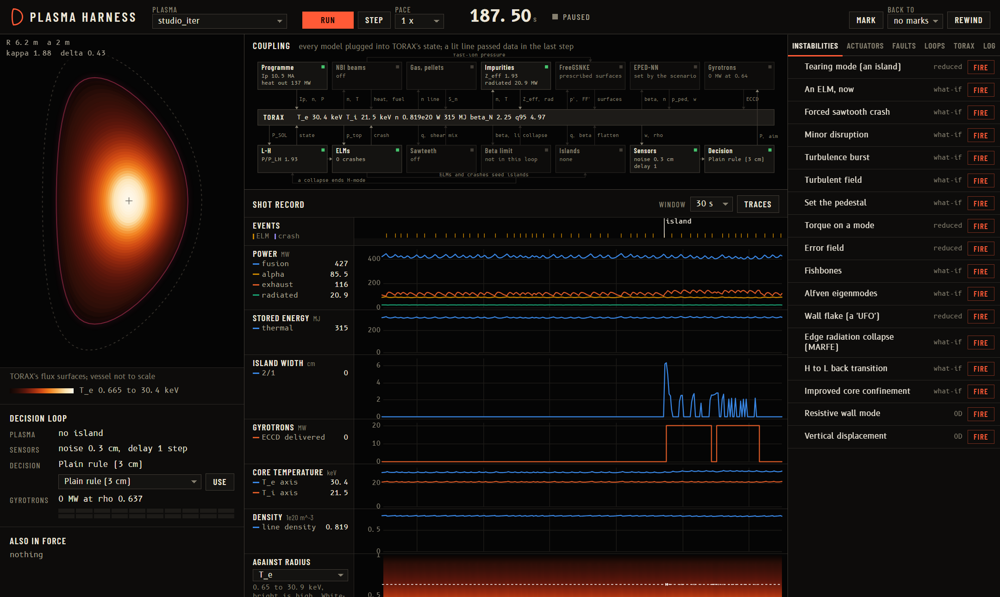
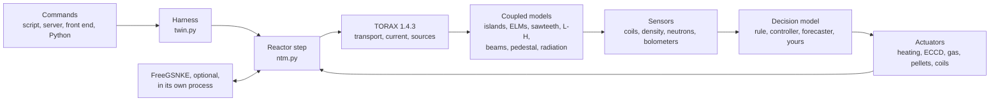

# Expanded TORAX

A whole-device tokamak simulator built on [TORAX](https://github.com/google-deepmind/torax) 1.4.3, with the physics a control test needs coupled to it, and a harness that lets a script, an AI agent or a person drive the plasma while it runs.

I built it to test real-time control chips and neural surrogates: on plasmas checked against real MAST shots, and on ITER, SPARC and MAST-U, which no shot here can check and which are labelled as such.



*The front end on ITER's hybrid scenario, paused at 187.5 s: a 2/1 island seeded at 6 cm, and the 20 MW of ECCD the scenario's rule fires at it.*

**Status.** Version 12 of the plasma settings, frozen on 9 November 2026, in package release 1.1. It runs whole MAST shots hands-off from their first measured frame and meets 6 of the 12 accuracy bars set for it. It is a test bench whose limits are measured, not a twin that matches shots: read [How far to trust it](#how-far-to-trust-it) before using any number it gives.

## Contents

- [Quick start](#quick-start)
- [What it adds to TORAX](#what-it-adds-to-torax)
- [How a step works](#how-a-step-works)
- [Scenarios](#scenarios)
- [The harness](#the-harness)
- [The front end](#the-front-end)
- [How far to trust it](#how-far-to-trust-it)
- [MAST shots](#mast-shots)
- [Optional pieces](#optional-pieces)
- [Where things live](#where-things-live)
- [Checks](#checks)
- [Releases](#releases)
- [Words used here](#words-used-here)
- [Credits and license](#credits-and-license)

## Quick start

You need Python 3.11 or newer. It was developed on Windows 11 with Python 3.13; the repository's CI runs the quick start on Ubuntu.

```bash
git clone https://github.com/Haripratiik/expanded-torax.git
cd expanded-torax
python -m venv .venv
```

Activate the environment (`.venv\Scripts\activate` on Windows, `source .venv/bin/activate` elsewhere), then install:

```bash
pip install -r requirements.txt
```

`requirements.txt` pins TORAX 1.4.3 and the JAX it was tested with. `requirements-lock.txt` pins every package of the tested environment, if you want exactly that.

Check what is there and what each piece enables:

```bash
python xtorax.py env
```

Only TORAX's environment and `data/epednn` are needed for the ITER and test scenarios that have no free boundary; everything else is optional ([Optional pieces](#optional-pieces)).

A first run, about a minute (the first step compiles TORAX's step with JAX):

```bash
python examples/run_iter.py
```

```text
flat top                   t  2.0 s   fusion   322 MW   Q  6.3   2/1 island  0.0 cm   ECCD  0.0 MW
3 s after a 4 cm island    t  5.0 s   fusion   364 MW   Q  5.1   2/1 island  0.8 cm   ECCD 20.0 MW
the same 3 s, no island    t  5.0 s   fusion   384 MW   Q  7.5   2/1 island  0.0 cm   ECCD  0.0 MW
```

The script takes ITER's hybrid scenario to 2 s, saves a snapshot, seeds a 4 cm 2/1 island and runs 3 s, then restores the snapshot and runs the same 3 s without the island. The scenario's rule fires 20 MW of ECCD at any island wider than 3 cm, which shrinks it to 0.8 cm; the branch without the island makes 20 MW more fusion power on 20 MW less heating, so its Q is 7.5 against 5.1. Both branches start from the same state, so the difference is the island and its ECCD.

The same session as a list of harness commands, and the front end on the same plasma:

```bash
python xtorax.py script studio_iter examples/iter_quickstart.json
```

```bash
python xtorax.py studio --scenario studio_iter
```

The front end opens at http://127.0.0.1:8801. It is ready in about a minute, while TORAX's step compiles; then press Run.

## What it adds to TORAX

TORAX evolves heat, particles and current on the plasma's flux surfaces (a 1.5D model: profiles across the radius, with the shape given). Expanded TORAX couples to it what a control test needs. Each part is tagged with its level: TORAX's own model, a published reduced equation, a published multi-machine law, or a prescribed effect (an assumed what-if).

| Part | What it does | Level | Module |
|---|---|---|---|
| Core transport | heat, particles and current on flux surfaces | TORAX | TORAX, `run_ntm.py` |
| Islands | neoclassical tearing modes: growth, rotation, braking, locking; seeds from sawteeth, ELMs and beta collapses | reduced (modified Rutherford equation with published terms) | `ntm.py` |
| ELMs, sawteeth | the ELM cycle from the exhaust power; Porcelli's sawtooth trigger (thermal terms) | reduced | `ntm.py`, `porcelli.py`, `coupled.py` |
| L-H transitions, beta limit | Martin 2008 with a low-aspect-ratio term; Piccione's no-wall limit at low aspect ratio | published laws | `lh_general.py`, `coupled.py` |
| Neutral beams | fast ions with slowing down, neutrons from the fast ions present; optional rebuilt atomic physics | reduced | `beams.py`, `beam_atomic.py` |
| Free boundary (optional) | the plasma's shape from measured or programmed coil currents every 10 ms, vessel currents from their circuit, the start checked against EFIT | FreeGSNKE 3.1.1 in its own process | `freeboundary.py`, `freegsnke_server.py`, `mast_machine.py`, `vessel.py` |
| Pedestal | height and width of the edge pedestal from EPED-NN | open model, weights in `data/epednn` | `epednn.py`, `pedestal.py` |
| Density | held on the machine's programme by a source shaped like the profile, with integral action; published particle transport (D from 0.4 to 0.67 of chi, AUG and JET) | a control idealization plus published ratios | `coupled.py`, `ntm.py` |
| Impurities, radiation | composition, dilution, line radiation (carbon out of coronal balance), and a bolometer reading that includes the scrape-off layer, divertor and hydrogen its view sees | TORAX plus reduced models | `impurities.py`, `radiation.py`, `edge_radiation.py`, `sol.py` |
| Fuelling by neutrals (optional) | KN1D from MAST's measured wall pressure: an oracle, not hands-off | KN1DPy in its own process | `neutrals.py`, `kn1d_server.py` |
| Actuators and instabilities | 21 commands: pellets, shattered pellets, gas, beams, heating, RMP coils, current ramps, density and radiation loops, fishbones, Alfven modes, MARFEs, back transitions, wall flakes, RWMs, VDEs, limits | each tagged torax, reduced, prescribed or margin | `actuators.py` |
| After a disruption | `quench`: on MAST, FreeGSNKE in 2D (which way the plasma goes); elsewhere DREAM | 2D or 1D codes | `mast_vde.py`, `dream_iter.py` |
| Sensors | magnetic probes and flux loops, line density, neutrons and the bolometers' total, read from the simulated plasma | synthetic diagnostics | `sensors.py`, `radiation.py` |
| Decision models | a rule, an island-equation controller, a forecaster (its trained weights are not included), or your own Python function | outside models | `controllers.py`, `forecaster.py` |
| Harness | named commands from a script, a local server or the front end; branches (snapshot and restore) | | `twin.py`, `harness.py` |
| Front end | live traces, profile maps, the cross-section, the console of actuators and instabilities, branches, measured data beside a real shot | | `studio.py`, `studio/` |
| Real shots | MAST shots from their first frame, hands-off; scoring against MAST; the readiness check | | `natural.py`, `mast.py`, `shot.py`, `whole_shot.py`, `readiness.py` |

## How a step works

One step of the loop, in outline:



A scenario file sets the machine, the plasma and the models. Each TORAX step (0.1 s on ITER, 1 ms on MAST) is followed by the coupled models, which read TORAX's profiles and write back what they change: an island's width flattens the profiles across it, an ELM or a sawtooth crash removes energy, the pedestal model resets the edge. The sensors read the result, the decision model chooses, and the actuators act before the next step. Commands arrive between steps. A snapshot holds everything a step reads, so a restored branch repeats the first run exactly.

## Scenarios

Scenarios are the JSON files in `scenarios/`. Name one without its `.json`.

| Scenario | Plasma | Needs |
|---|---|---|
| `studio_iter` | ITER's 10.5 MA hybrid scenario (TORAX's own example), with the island model and an ECCD rule on 20 MW of gyrotrons | nothing more |
| `studio_iter_15MA` | ITER at 15 MA with sawteeth, in the hybrid's geometry | nothing more |
| `harness_demo`, `stress`, `baseline_natural` | test plasmas for the harness and its commands | nothing more |
| `studio_iter_coupled` | ITER's hybrid with FreeGSNKE's shape and EPED-NN's pedestal | FreeGSNKE |
| `twin_iter_baseline`, `twin_iter_baseline_v5` | ITER's 15 MA baseline, no tuning: QLKNN, FreeGSNKE, EPED-NN, beams, one coupled loop | FreeGSNKE |
| `twin_sparc`, `twin_sparc_v5` | SPARC's primary reference discharge, no tuning: 25 MW of RF to reach H-mode, then the reference 11.1 MW | FreeGSNKE |
| `twin_mastu` | MAST-U, no shots and no tuning | FreeGSNKE |
| `studio_mast_23906` | MAST shot 23906 from its real start, nothing measured afterwards | MAST shot files |
| `studio_mast_handsoff_20689`, `studio_mast_handsoff_23906` | MAST shots run hands-off with version 12 | MAST shot files, FreeGSNKE |
| `studio_iter_2d_solver`, `studio_iter_2d_surrogate` | the 2/1 island from a 2D solver or its neural surrogate | the 2D solver, not part of this release |

The `_v5` scenarios use version 5 of the island model. ITER, SPARC and MAST-U run from machine files (`core/machines.py`) and are beyond the range any shot here checks: report their numbers that way.

## The harness

The same named commands reach a plasma three ways:

| Way | Command |
|---|---|
| a script | `python xtorax.py script SCENARIO COMMANDS.json`: each command in order, each answer printed as JSON |
| a server, for an agent or a program | `python xtorax.py serve SCENARIO --port 8801`, then POST a command as JSON to http://127.0.0.1:8801/, GET /observe, GET /help |
| one command to a running server | `python xtorax.py call '{"cmd": "step", "until": 25}'` |
| Python | `twin.Harness(scenario)` then `h.apply({...})`, as in `examples/run_iter.py` |

The server listens on this machine only, runs one command at a time and takes named commands, never code. Times are seconds of plasma time: `until` is absolute, `n` counts TORAX steps.

| Kind | Commands |
|---|---|
| time | `step` (n steps, or until t), `observe` (`profiles: true` adds T_e, T_i, n_e and q) |
| instabilities on demand | `island` (m, n, w_cm), `kick`, `crash`, `elm`, `turbulence`, `turbulence_noise`, `error_field`, `brake` |
| plasma edits | `profile`, `pedestal`, `pedestal_model` (EPED-NN), `physics` (island coefficients), `set` and `get` (any TORAX runtime parameter) |
| coupled tools | `free_boundary` (FreeGSNKE: ITER, or MAST on a MAST shot), `couple` (every model on one plasma) |
| after the onset | `quench` |
| plant | `heating`, `trip`, `mirror_stuck`, `sensor_bias`, `drive`, `decision` |
| branches | `snapshot`, `restore`, `save` |
| actuators and instabilities | `pellet`, `spi`, `gas`, `laser_blowoff`, `nbi`, `icrh`, `ecrh`, `rmp`, `ip`, `density_control`, `radiation_control`, `mitigation`, `fishbone`, `alfven`, `wall_flake`, `marfe`, `back_transition`, `transport_barrier`, `rwm`, `vde`, `limits` |

`{"cmd": "help"}` lists every command with its parameters, defaults and ranges; [AGENTS.md](AGENTS.md) has them in tables, with the rules an agent should keep. Examples: `examples/iter_quickstart.json` (the quick start's session), `examples/run_iter.py` (the same from Python), `examples/agent_session.json` (ITER: an island, a branch, a shattered pellet and the quench, which needs DREAM), `examples/mast_session.json` and `examples/run_shot.py` (a MAST shot hands-off, which needs MAST shot files).

## The front end

`python xtorax.py studio` serves a page at http://127.0.0.1:8801 with the plasma's live traces, profile maps, the cross-section, the console of actuators and instabilities, branches, and, on a real shot, what MAST measured beside the simulation. It starts on MAST shot 20689 if the workspace has its files, otherwise on `studio_iter`; `--scenario` picks another.

## How far to trust it

Everything in this section was measured unless it says inferred. Codes such as H86 name tests in my research log, which is not published; the numbers they produced are given here.

### Whole MAST shots, version 12

The main check. The 25 development MAST shots that can be scored, each run hands-off from its first measured frame (Thomson and charge-exchange profiles, EFIT's equilibrium, the fast ions filled from the measured beam history) with only the machine's programme given (plasma current, coil currents, beam power, the programmed density), one seed, scored every 5 ms against what MAST measured. "Error" is the median over all run-times; "inside" is the share of run-times inside the bar; "signed" is the median over shots of each shot's signed error, with the 10th to 90th percentile across shots. Bars: 10% for relative quantities, 0.05 for elongation and triangularity, 2 cm for positions.

| Quantity | Error | Inside | Signed (10 to 90% of shots) | At the bar? |
|---|---|---|---|---|
| plasma current (given as the programme) | 2.3% | 99% | -2.3% (-6 to +1) | yes |
| stored energy as MAST's EFIT reads it (whmd, from the twin's own equilibrium) | 6.4% | 73% | +3.7% (-7 to +12) | yes |
| q95 | 7.8% | 65% | -6.6% (-14 to +1) | yes |
| minor radius | 2.7% | 99% | -1.3% (-4 to +4) | yes |
| triangularity | 0.026 | 81% | -0.003 (-0.03 to +0.03) | yes |
| vertical position | 0.56 cm | 99% | -0.5 cm (-1.0 to -0.1) | yes |
| line density | 13.0% | 41% | -11.8% (-39 to +2) | no |
| core electron temperature | 12.9% | 40% | +0.4% (-11 to +32) | no |
| axis radius | 2.32 cm | 44% | +1.4 cm outward (-0.6 to +4.4) | no |
| elongation | 0.086 | 29% | -0.063 (-0.18 to +0.07) | no |
| neutrons | 33.8% | 12% | +13% (-33 to +81) | no |
| radiated power (the bolometers' total) | 76% low | 3% | -70% (-94 to -36) | no |

Two more energies: the thermal energy against Thomson's kinetic energy, 21.6% per shot (signed -7%, -29 to +20); the thermal plus fast-ion energy against the energy EFIT's own beta_pol gives, signed +19% (-12 to +64; worst shot 240%), the fast-ion surplus described below.

Profiles, relative RMS over 0.1 < rho < 0.9 against Thomson (T_e, n_e) and charge exchange (T_i), median over shots, with holding the first frame in brackets:

| Profile | 5 ms | 20 ms | 50 ms | 100 ms | 200 ms |
|---|---|---|---|---|---|
| T_e | 9% (14) | 11% (27) | 17% (42) | 20% (58) | 21% (70) |
| T_i | 17% (30) | 29% (50) | 41% (80) | 33% (91) | 35% (95) |
| n_e | 12% (9) | 15% (16) | 15% (30) | 27% (47) | 14% (63) |

The simulation beats holding the start from about 20 ms on, on all three.

All 25 runs reach the end of their window; one (18464) disrupts on its own 41 ms early, from too many fast ions at low density. Events over the time both ran (simulated; measured): ELMs 271; 237, sawtooth crashes 85; 107, share of time with an n = 1 mode 0.43; 0.31, share in H-mode 0.29; 0.10. Within a factor 2 of MAST, share of shots: ELMs 36%, crashes 56%, n = 1 mode time 44%, H-mode time 32%; H-mode on 8 shots that stayed in L-mode. By the readiness criteria written before the work, version 12 meets the harness criterion only: runs (one self-disruption), quantities (6 of 12) and events (under two thirds of shots) are not met.

Repeat runs: the same shot, version and seed run twice give the same numbers on some shots and not on others. 20689 scored identically; 16458 matched to the fifth digit at the start and then drifted (q95 error 3.0% against 3.3%, outer edge 5.2 against 5.3 cm). Code, settings and inputs were the same and no timing enters any decision, so the drift is floating-point differences between runs (inferred). A difference between two options on one shot smaller than this is not a result.

<details>
<summary>Across versions 9, 11 and 12</summary>

| Quantity | version 9 | version 11 | version 12 |
|---|---|---|---|
| line density | 22.4% | 22.5% | 13.0% |
| core T_e | 14.7% | 14.5% | 12.9% |
| whmd | 6.3% | 6.3% | 6.4% |
| q95 | 8.3% | 8.1% | 7.8% |
| elongation | 0.078 | 0.074 | 0.086 |
| axis radius | 2.26 cm | 2.04 cm | 2.32 cm |
| radiated power | 96% low | 88% low | 76% low |
| neutrons | 34.6% | 34.6% | 33.8% |
| runs not reaching their end or disrupting early | 1 | 2 | 1 |

</details>

### What sets each error

- **Density.** MAST had no density feedback: its valves ran pre-programmed waveforms, and its main inboard valve could not be shut during a shot, so its density follows the wall. The simulation holds the density on MAST's programmed line density where there is one, else on the start's Greenwald fraction; that programme itself sits a median 14% from MAST's density per shot (-62% on 22235, +30% on 20689), so holding it exactly cannot do better. Every published fuelling model keeps one number for how much gas a machine's wall keeps, which the rule below keeps out of the general code.
- **Fast ions.** On MAST's measured profiles the beam model holds 2.04 times the fast-ion energy EFIT allows (EFIT's energy minus the kinetic), 1.69 times with the atomic physics rebuilt from published sources; neutrons from the fast ions present come to 1.15 and 0.91 of measured. This shows as the pressure-energy surplus (+19%), the outward axis (+1.4 cm), 18464's beta-limit collapse and the neutron scatter. What removes the rest is not settled: redistribution by MAST's modes (TRANSP needed about twice the anomalous fast-ion diffusion with MAST's long-lived mode; no published law sets the size) and charge exchange on edge neutrals (needs the wall).
- **H-mode.** The threshold is Martin 2008 with a low-aspect-ratio term from MAST, NSTX and Pegasus together; on MAST it gives 5 to 6 times Martin where MAST's own measurements give 8 to 10 times (Howlett 2023), so the simulation enters H-mode too readily. The shots it gets wrong sit inside the published fit's scatter (a factor 1.36 either way) 40 to 100% of the time: no published threshold decides them.
- **Radiated power.** MAST's prad_pol is a weighted sum over one midplane fan of 16 chords that sees the confined edge, the X-point regions and the inner divertor legs. The simulated reading sums the core (1 to 33 kW), carbon in the scrape-off layer and divertor (TORAX's extended Lengyel model with Eich's heat-flux width, 1 to 47 kW on most shots), the inner legs' recycled hydrogen (2 to 5 kW) and the main chamber's hydrogen when neutrals are run (11 to 81 kW). MAST's bolometers read 90 to 340 kW. The Lengyel term is steep: across its published inputs it spans a factor 30.
- **Shape.** The elongation sits 0.02 below EFIT's at the start and drifts to 0.10 below after 150 ms; the drift grows with how elongated MAST makes the plasma and does not follow the pressure excess. A lead, inferred and untested: FreeGSNKE's MAST coil description against EFIT's. The free boundary is forced up-down symmetric, so the vertical position is good only because these shots sat near the midplane.
- **Core temperature.** Unbiased in the median but scattered (-11 to +32% across shots); T_i profiles 33 to 41% after 50 ms. Core transport is TORAX's Bohm-gyroBohm held to published confinement laws; no transport network is valid at MAST's aspect ratio (TGLF-NN's spherical models were tested and did not help).
- **Sawteeth.** Porcelli's trigger with its thermal terms only. Crashes 85 against 107 measured: frequent real sawteeth on beam-heated shots are undercounted.
- **n = 1 modes.** Most of MAST's n = 1 activity is internal kinks near q_min = 1, which the simulation reads from its own q profile (q_min at or under 1.12 with beams on, Chapman et al. 2010). Its q_min tracks EFIT's moderately (correlation of mode share 0.45 across shots). What the mode does (rotation braking, fast-ion losses) is not modelled.
- **Starts.** FreeGSNKE's static solve at the start found the wrong plasma on 12 of 25 shots; it is now checked against EFIT and retried.

<details>
<summary>The error budget with the density held on the measured value</summary>

With the line density held on Thomson's measured mean (an oracle run, not a mode for use): line density 4.3%, thermal energy 22 to 16%, radiated power 88 to 77% low; neutrons (34 to 33%) and core T_e (14.5 to 15.6%) barely move, and H-mode gets worse (time 0.42 against 0.09, false on 9 shots) because density lowers the threshold. So density alone would add one quantity; neutrons, temperature, H-mode and radiation need their own fixes.

</details>

<details>
<summary>Options built, tested and not adopted</summary>

| Option | Measured | Why not |
|---|---|---|
| Beams rebuilt from published atomic physics (`beam_options`: Suzuki stopping, halo charge exchange, the plasma's Coulomb logarithm, orbit averaging) | fast-ion energy on measured profiles 2.04 to 1.69 times EFIT's; neutrons 33.8 to 30.3% | absorbs more power, moves the axis out (2.3 to 3.1 cm), more self-disruptions, sawtooth chatter |
| Each shot's measured beam energy split (`species: "measured"`) | old shots' neutrons nearer (16148: 1.86 to 1.37 of measured) | adopted only inside the rebuilt beams, which were not |
| Fuelling by neutrals from MAST's measured wall pressure (`fuelling: kn1d_gauge`, KN1D) | L-mode shots: line density -8 to -23%; H-mode shots: +77 to +330% | an oracle; in H-mode the edge source piles up to ten times MAST's edge density |
| The scrape-off layer's own particle balance (`sol: balance`) | separatrix 0.7 of the line average at a D_perp of 1 m^2/s; the core's density doubled in 25 ms | MAST's measured D_perp (1 to 5 m^2/s) untested |
| ELMs taking particles out with the density pin off | no change on the H-mode overfuelling | the edge shelf, not the ELMs |

</details>

<details>
<summary>Earlier checks against real data</summary>

| What | Real data | Result |
|---|---|---|
| Profiles, replay with the edge given | JET, 20 discharges | T_e 12 to 19%, T_i 14 to 22%, n_e 12 to 18%, stored energy 9 to 17% at 0.5 to 2 s; C-Mod worse, T_e up to 32% |
| Profiles, hands-off | JET, C-Mod | JET T 20 to 38%; C-Mod fails on 2 of 5 |
| Response to a change in heating | JET, 20 starts; MAST, 17 beam steps | JET T_e 15 to 19% with the edge given (holding 43 to 55%); MAST step up T_e 13% at 50 ms (holding 27%) |
| Island growth and width | MAST, 418 n = 1 and 104 3/2 modes | median width 0.73 to 1.10 of real; little skill on which grows (AUC 0.57 to 0.65) |
| Island model, version 5 | MAST n = 1; ITER against published numbers | width distribution error 0.23 to 0.32; ITER seed to lock 1.5 to 1.8 s (published 1.4 to 2.4), saturated width 34 to 35 cm (published 32) |
| Time from onset to lock, given the real width | MAST, 418 modes | 18 against 39 ms: 2.2 times too fast |
| Sensors from the simulated plasma | MAST pickup coils | coil places right to about 5 cm, readings within 4 to 14% on real maps |
| Which way MAST's plasma goes after the thermal quench | 40 real disruptions | 12 of 13 where the collapse clearly moves the equilibrium |
| DREAM after the onset | Vallhagen et al. 2020, three published cases | reproduced; ITER runaways 3.1 to 7.3 MA whatever the timing |
| The most extreme real shots | MAST, 92 shots | the worse profile channel 1.4 to 1.6 times its typical error; nothing runs away |

</details>

### Not modelled

3D fields (no island shape, no mode coupling, no stochastic field); rotation evolved by TORAX (one number per mode); the wall and its fuel inventory; the main chamber's neutrals without the oracle; a 2D scrape-off layer (edge models return separatrix and target values along one field line); fast-ion redistribution by modes; the disruption past the start of its thermal quench outside the `quench` command; real vertical motion in the running loop (MAST runs are forced symmetric); resistive wall modes and vertical displacements beyond 0D margins; MAST's sudden density losses; a pellet's path; ECCD response against shots (no machine here has ECCD data; the island's drive was checked against one published criterion only).

### Beyond the checked range

ITER, SPARC and MAST-U run from machine files with no shots to check them: shapes within 0.03 to 0.07 of published and no solve refused. Fusion power is under design on the general settings from machine files alone (SPARC 67 MW against its 140 MW design; ITER's 15 MA baseline 173 MW against 500 MW), while ITER's 10.5 MA hybrid scenario reaches 343 MW and Q 6.5. Report any number from these machines as beyond the checked range.

### Rules the physics keeps

No law fitted to MAST enters the general code: coefficients come from published multi-machine work or from physics, a machine file holds hardware and programmes only, and MAST's measurements may check a model, never set it. Three fixes are ruled out by that rule and left open: a wall number per machine, MAST's measured L-H threshold in its machine file, and the size of fast-ion redistribution by MAST's modes. Versions are frozen: a change becomes a new version only after it has been scored on all 25 shots, compared with the recommended version on the same starts, and found better.

## MAST shots

A whole MAST shot needs files in the workspace's `runs/twin/`: the shot file and coil traces (`mast_natural2/shots/`, `coils/`), the start's extras (`mast_natural/extras/`), the instability laws (`mast_natural2/laws.json`), FreeGSNKE's MAST machine (`freeboundary/mast_machine2/`) and, for scoring, EFIT's signals (`whole82/real/`). They are made from FAIR-MAST's TokaMark v1 data, which is public, by the tools in `core/`: `mast.py` and `mast_convert_natural.py` (profiles, equilibrium and programme), `mast_machine.py` (FreeGSNKE's machine), `mast_scalars.py`, `whole_shot_efit.py`, `mast_vde.py`, and `fairmast.py`, `gas_extract.py` and `beam_species.py` for extra signals. They read a local zarr copy of the data (`XTORAX_MAST_STORE`, default `~/data/mast/tokamark_v1`) in an environment with zarr (`env/fairmast-venv.txt`). They are included as they ran; making the data is not yet a single command, and the shot files are not distributed here.

With the files in place:

| Command | What it does | Time |
|---|---|---|
| `python xtorax.py shots [--all]` | the shots that can be run, and those that can also be scored | seconds |
| `python xtorax.py run SHOT ... \| --scorable [--version V] [--tag T] [--seeds N] [--lanes N] [--extra JSON]` | whole shots hands-off from their first frame, writing `runs/twin/mast_natural2/<tag>/`; `--lanes` runs up to 3 processes; `--extra` adds override keys to the version's | 1 to 4 min a shot |
| `python xtorax.py score TAG` | scores runs against MAST every 5 ms, beside holding the first frame | 1 to 2 min |
| `python xtorax.py compare A B` | two scored sets on the same starts and times | 1 min |
| `python xtorax.py ready NAME` | a scored set against the readiness criteria | 1 min |
| `python xtorax.py versions` | every frozen version and the recommended one | seconds |

A run writes `results.jsonl` (one line per run: start, end, events, the free boundary's log), `<shot>_<seed>.npz` (scalars every step) and `<shot>_<seed>_prof.npz` (profiles). A MAST run with FreeGSNKE takes 2 to 3 GB of memory, so run at most three at once.

If the workspace keeps a list of development shots, `runs/twin/dev_shots.json` (`{"development": [shot, ...]}`), runs and scores refuse every other shot. I kept one so that shots held out for testing other work were never run by mistake; without the file every shot with files may run.

## Optional pieces

| Piece | For | Setup | Variables |
|---|---|---|---|
| FreeGSNKE 3.1.1, in its own environment (it needs numpy under 2.5) | the free boundary: `studio_iter_coupled`, the `twin_*` scenarios, hands-off MAST runs, `quench` on MAST | a new environment with `pip install -r env/freegsnke-venv.txt`; FreeGSNKE's source checked out in `external/freegsnke` for its machine descriptions (a commit after 3.1.1 loads ITER's machine) | `XTORAX_FREEGSNKE_PYTHON`, `XTORAX_FREEGSNKE_SRC` |
| KN1DPy | fuelling by neutrals (an oracle) | from its source; its installer misses `jh_bscoef.npz`, which goes into `site-packages/KN1DPy/rates/johnson_hinnov/` by hand | `XTORAX_KN1D_PYTHON` |
| DREAM | `quench` off MAST | built from source; on Windows, in WSL | `XTORAX_DREAM_PYTHON`, `XTORAX_DREAMPATH` |
| zarr | FAIR-MAST downloads and the MAST tools | a new environment with `pip install -r env/fairmast-venv.txt` | `XTORAX_FAIRMAST_PYTHON`, `XTORAX_MAST_STORE` |
| The 2D island solver and its surrogate | `studio_iter_2d_solver`, `studio_iter_2d_surrogate` | not part of this release; they belong to a separate project | `solver/` and `models/` in the workspace |
| The etched chip | the decision model `etched` | not part of this release; it belongs to a separate project | `XTORAX_CHIP_SERVER` |

A variable names that piece's Python (or folder); without it the tools look in `external/<environment>/` of the workspace. `XTORAX_PYTHON` overrides the Python that `xtorax.py` uses for its own runs, which is otherwise the one running it. `python xtorax.py env` reports what it finds.

## Where things live

| Path | What it holds |
|---|---|
| `xtorax.py` | the entry point: env, versions, shots, run, score, compare, ready, script, serve, call, studio, smoke |
| `core/` | the simulator and harness, 54 modules (map below) |
| `scenarios/` | 16 scenarios: ITER, SPARC, MAST-U, MAST shots, test plasmas |
| `studio/` | the front end's page, script and style |
| `examples/` | the quick start's session and script, an ITER agent session, a MAST session |
| `data/epednn/` | EPED-NN's weights and their check outputs |
| `env/` | the package lists of the four environments, as frozen on 9 November 2026 |
| `docs/` | the picture at the top of this file |
| `AGENTS.md` | the operating manual for an AI agent driving the harness |

Results, MAST data and outside tools live in a workspace: `XTORAX_HOME` if set, else the repository itself. Results and data go in its `runs/twin/`, outside tools in its `external/`; git ignores both.

| Group | Modules in `core/` |
|---|---|
| entry points | `harness.py`, `studio.py`, `natural.py` |
| the reactor and harness | `ntm.py` (TORAX plus islands, ELMs, the step), `twin.py` (scenarios, commands, branches), `actuators.py`, `impurities.py`, `sensors.py`, `run_ntm.py` |
| the coupled plasma | `coupled.py`, `machines.py`, `lh_general.py`, `porcelli.py`, `beams.py`, `beam_atomic.py`, `epednn.py`, `pedestal.py`, `freeboundary.py`, `freegsnke_server.py`, `mast_machine.py`, `vessel.py`, `radiation.py`, `edge_radiation.py`, `sol.py`, `neutrals.py`, `kn1d_server.py`, `tglfnn_st.py` |
| real shots | `mast.py`, `shot.py`, `mast_anchor.py`, `whole_shot.py`, `whole_shot_efit.py`, `readiness.py`, `density_drops.py`, `mast_convert_natural.py`, `mast_scalars.py`, `fairmast.py`, `gas_extract.py`, `beam_species.py` |
| after the onset | `mast_vde.py`, `dream_iter.py` |
| decision models | `controllers.py`, `forecaster.py`, `chip_forecaster.py` (the forecaster's quantized form; training it needs a separate project's hardware flow), `island2d.py`, `loop2d.py`, `adversary.py` |
| checks | `check_reactor.py`, `check_plant.py`, `check_pellet.py`, `check_edge.py`, `check_coupled.py`, `check_branches.py`, `check_quench.py` |

## Checks

| Check | What it shows |
|---|---|
| `python xtorax.py smoke` | the functional checks one after another, pass or fail, in `runs/twin/smoke/summary.txt`; a check whose optional piece is missing is reported as skipped |
| `python core/check_reactor.py` | the steppable reactor against saved traces of the same setup, a branch repeated bit for bit, and each edit doing what it says |
| `python core/check_plant.py` | every actuator does what it says, on branches of one ITER plasma |
| `python core/check_coupled.py [--mast]` | EPED-NN, FreeGSNKE, the growth rate, a heating step and branches through the harness's commands |
| `python core/check_branches.py [--case mast iter]` | branches come back exactly: a snapshot, a run, a branch with a pellet, gas, an island and heating fired, back to the snapshot, the same run again; every record must match the first run's |
| `python core/check_quench.py` | `quench` on a MAST shot and on ITER |
| `python core/epednn.py check` | EPED-NN's outputs against EPEDNN.jl's on the same inputs |
| `python xtorax.py ready NAME` | a scored set of MAST runs against the readiness criteria |

## Releases

| Release | What changed | Whole-shot results |
|---|---|---|
| 1.0, 9 November 2026 | version 12 frozen and packaged | the reference set |
| 1.1, 9 November 2026 | exact branches; pellets sized by the machine's injector | unchanged: shot 20689 identical on all 46 scores |

**Branches in 1.1.** In 1.0 a snapshot kept TORAX's state, the reactor's islands and ELM clock, the plant and the harness's own lists, but not the models a step calls, so a restored branch carried on with the last branch's coupled plasma: on 20689 a null branch run after a branch that fired a pellet, gas, an island and heating was in H-mode from its first step, because the fired branch was. An AI agent driving the harness found the transport table leaking the same way. A snapshot now also holds every model on the step (the coupled plasma's random draws, H-mode, collapse and density-loop state, the transport table, EPED-NN's schedule, the free boundary's client), the reactor's carried readings, the free boundary's geometry, the ELM draws, and FreeGSNKE's own state. Measured: on MAST 20689 with FreeGSNKE and on ITER with FreeGSNKE and EPED-NN, the null branch and a second restore repeat the first run exactly on every record (74 and 42 quantities, 40 steps each); a snapshot takes 0.01 s and a restore 0.01 to 0.04 s.

**Pellets in 1.1.** The `pellet` command took a sphere's radius with a 3 mm default: 6.8e21 atoms, ITER's scale and about 50 times the electrons of a MAST plasma such as 20689's. Sizes now come from each machine's injector in `machines.py`: MAST's made cylinders 1.1, 1.35 and 1.7 mm long and wide, holding 0.6, 1.2 and 2.4e20 atoms, fired at 240 to 450 m/s from the top into the high-field side ([Valovič et al. 2008](https://iopscience.iop.org/article/10.1088/1742-6596/123/1/012039/pdf)); ITER's makes 5 mm fuelling and 3 mm ELM-pacing pellets. With no size given a pellet is the machine's default, `d_mm` takes an injector's size and `r_mm` a sphere's radius, and the answer gives the pellet's atoms and their share of the plasma's electrons, with a warning above one. On 20689 the 1.1 mm pellet raises the line density 47% at once and 21% after 10 ms, an e-folding of about 12 ms, inside MAST's measured retention of 2 to 20 ms in L-mode.

## Words used here

| Word | Meaning |
|---|---|
| TORAX | Google DeepMind's open tokamak transport code, written in JAX: it evolves temperature, density and current profiles in time |
| flux surface, rho | the nested magnetic surfaces a tokamak's field lines lie on; rho labels them from the centre (0) to the edge (1) |
| q, q95, q_min | the safety factor: how many times a field line goes round the long way per turn the short way; q95 near the edge, q_min its lowest value |
| island, 2/1, NTM | a neoclassical tearing mode: the field tears and reconnects into a magnetic island on the surface where q = m/n (2/1: q = 2); it flattens the profiles across it, and a large one can lock to the wall and end the shot |
| ECCD | electron cyclotron current drive: microwaves from gyrotrons that drive current where they are aimed, used to shrink an island |
| ELM | an edge-localized mode: a burst that throws out part of the edge pedestal in H-mode |
| sawtooth | a periodic crash of the core temperature when q at the centre falls below 1 |
| L-mode, H-mode, L-H | low and high confinement; H-mode has a steep edge pedestal and starts above a threshold power (the L-H transition) |
| pedestal | the steep edge region of an H-mode plasma, whose height sets much of the core's performance |
| beta_N | normalized plasma pressure; above a limit the plasma goes unstable |
| Greenwald fraction | the density over the Greenwald limit, above which density limit disruptions are common |
| H98 | confinement time over the IPB98(y,2) scaling's prediction |
| Q | fusion power over the heating power put in |
| EFIT | the equilibrium reconstruction MAST ran on its measurements: the shape, q and stored energy |
| Thomson, charge exchange | the laser and beam diagnostics that measured MAST's electron and ion profiles |
| NBI, ICRH, ECRH | neutral beam injection, and heating by ion and electron cyclotron waves |
| SPI, MARFE, RWM, VDE | shattered pellet injection; a radiating condensation at the edge; a resistive wall mode; a vertical displacement event |
| hands-off | a real shot run from its first measured frame with only the machine's programme given afterwards |
| branch | a snapshot and a restore: the same state run two ways |

## Credits and license

Apache License 2.0 ([LICENSE](LICENSE)); third-party work and its licenses are listed in [NOTICE](NOTICE). Built on [TORAX](https://github.com/google-deepmind/torax) (Apache 2.0), with EPED-NN's weights from [EPEDNN.jl](https://github.com/ProjectTorreyPines/EPEDNN.jl) (Apache 2.0); [FreeGSNKE](https://github.com/FusionComputingLab/freegsnke), KN1DPy and DREAM are optional and not shipped. MAST data come from FAIR-MAST (Jackson et al., SoftwareX 27, 101869, 2024). Expanded TORAX is an independent project, not affiliated with or endorsed by Google DeepMind or the UK Atomic Energy Authority.
